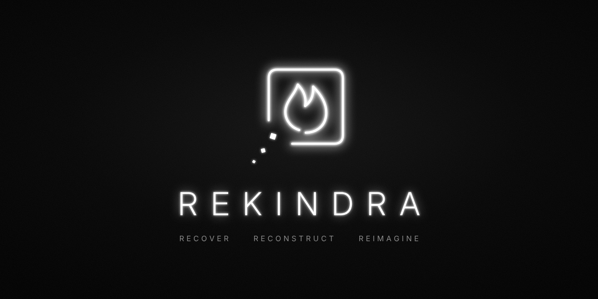

# Rekindra

Recover, Reconstruct, Reimagine. Point Rekindra at an old folder of images, notes, PDFs and archives. It recovers what it supports, keeps recovered material separate from invented material, and lets your Hermes agent build an original animated scene from the result that exports to WebM. Your source files are never modified.

## Install

```sh
hermes plugins install https://github.com/jakeefr/rekindra
hermes plugins enable rekindra
```

Restart Hermes after installing. Once the catalog entry is merged, `hermes plugins install rekindra` will work as well.

## Quick start

Start a new Hermes session and ask, for example:

- "Use Rekindra to inspect `~/Documents/old-backup` and recover what you can. Tell me what could not be recovered and why."
- "Reconstruct the recovered photos and notes into one offline page, in order, and list the gaps."
- "Build an original animated world from the recovered images, preview it, fix any warnings, then export it as a WebM video."

## Tools

| Tool | What it does |
| --- | --- |
| `rekindra_inspect` | Bounded folder inventory with source snapshots, hashes and explicit skips. Unsupported files are named from their leading bytes without being opened or run. |
| `rekindra_recover` | Recovers images to normalized PNG copies (an original TGA decoder, plus JPEG, PNG, BMP, GIF, TIFF, PCX, ICO, WebP, PPM, QOI, SGI and DDS through Pillow) and text, Markdown, JSON, CSV, ZIP text members and PDF text as quoted evidence with citable IDs, all with provenance. |
| `rekindra_status` | Shows the saved inventory and recovered artifacts. |
| `rekindra_reconstruct` | Checks an agent-proposed order of recovered material against real evidence and writes one self-contained offline HTML page, with recovered and inferred content labelled and gaps listed. |
| `rekindra_plan` | Optional separate host-owned structured model call that infers mood and saves a scene plan. |
| `rekindra_build` | Rebuilds a saved plan after verifying source integrity. |
| `rekindra_compose` | Validates an agent-authored scene and builds a portable offline HTML player with an ASCII mode and silent WebM export. |
| `rekindra_create_world` | Creates generated geometry, animated surfaces, atmosphere, materials and a moving camera from the agent's interpretation of recovered images, recovered text, or both. |
| `rekindra_preview` | Renders a saved scene into a timed PNG contact sheet in an isolated local browser, and reports palette drift, backdrop edges and other flagged defects. |
| `rekindra_export` | Clears a previewed world for video, refusing unresolved warnings until they are revised or acknowledged with a reason, and writes the world HTML that can save WebM. |
| `rekindra_revise_world` | Applies bounded field edits to a new immutable world plan for review. |

The recommended flow is inspect, recover, then let the agent view selected images with your consent and read the recovered evidence before calling `rekindra_compose` or `rekindra_create_world`. A world then goes through `rekindra_preview`, any revisions, and `rekindra_export`. `rekindra_create_world` and `rekindra_revise_world` accept `preview: true` to return the preview in the same call. Creative output is labelled generated: it is a new interpretation, not a recovery of a photograph's true 3D scene. The optional scene building blocks (figure rig, wings, drapes, rings, atmosphere, ASCII detail modes) are described in [docs/world-authoring.md](docs/world-authoring.md).

To save a video, open the exported HTML in a current Chromium browser, optionally select **ASCII** (leave **ASCII color** checked for full color, uncheck it for black-and-white), and choose **Save video**. Export uses native WebCodecs VP8 and Rekindra's own WebM writer.

## Requirements

- Hermes `>=0.22.7`.
- Python 3.11 to 3.14.
- `pypdf>=6.21.4,<7` and `Pillow>=13.0.0,<14`. Hermes asks before installing them. Without pypdf, PDFs are reported as unsupported; without Pillow, images other than the original TGA decoder's are. Everything else works.
- An installed Chrome, Edge or Chromium for preview and export.

## What this plugin does on your machine

**Network.** Rekindra makes no network calls of its own and has no telemetry. Tool results, including recovered text and file names, go to your active Hermes model like any other tool result, so they reach whichever provider you use. `rekindra_plan` sends selected image bytes to that model only when called with `send_images=true`. If the agent opens a recovered image or preview with Hermes' own vision tools, that image goes to the model too.

**Files it reads.** Only the folder you name, read-only, working from snapshots. In that folder it skips files and directories named `.git`, `.ssh`, `.aws`, `.azure`, `.gnupg`, `.venv`, `node_modules`, `__pycache__`, `.env` and `.env.*`. The filter applies to names on disk only: text files inside a ZIP are not filtered by name, so do not point Rekindra at an archive that holds secrets. Your source files are never modified.

**Files it writes.** Only under `$HERMES_HOME/plugin-data/rekindra`.

**Child processes, never through a shell.**

- An isolated Python reader (`-I -S -B`) decodes images and PDFs. It gets only `SYSTEMROOT` and `PATH`, runs with a time limit, and is killed if it overruns.
- Rendering a preview starts a headless copy of your installed Chrome, Edge or Chromium, or the browser named by the optional `REKINDRA_BROWSER` variable. It uses a temporary profile inside the project with background networking turned off, runs one at a time with a 45 second limit, inherits Hermes' environment variables with temp and cache paths redirected, and loads only a local generated page.
- On Windows, `taskkill` ends a preview browser that overruns.

**Background processes.** None remain once a tool call returns.

**Credentials.** Rekindra stores none and declares no required environment variables. Model access is through Hermes.

**Dependencies.** `pypdf>=6.21.4,<7` and `Pillow>=13.0.0,<14`, each run in a separate, killable process. They are decoders, not creative engines. Hermes asks before installing them.

**Untrusted content.** Recovered text is labelled as untrusted quoted data for the agent, which is told not to follow instructions inside it. That is guidance to the model, not a guarantee.

## Limitations

- Platform: tested end to end on Windows only. macOS and Linux are not verified.
- Input limits: 500 files, 100 MB per file, 500 MB total snapshots, 2,000 visited directory entries, depth 32, and 20 million decoded pixels. Limits, excluded paths, unreadable inputs and links appear in the skipped report. Do not supply a store and source that overlap. One Hermes process may write a given store; this is not a hostile multi-user filesystem sandbox.
- Rekindra does not repair, complete or run games or software projects. Nothing in a folder is compiled, executed or rebuilt.
- PDF text is read page by page, up to 32 pages. There is no OCR: a scanned or image-only PDF is reported as having no extractable text, and an encrypted one as encrypted.
- Partial recovery covers damaged JPEG, PNG, BMP, GIF, PCX, PPM and TIFF only, and keeps only the pixels that really decoded. Other damaged images are refused, including a truncated TGA. Multi-frame files recover the first frame and say so.
- The TGA decoder supports 24/32-bit true color (types 2 and 10), no color map or interleaving. This is not universal damaged-image repair.
- A file Rekindra cannot read is named from its file signature when the signature is known, and otherwise reported as having no known file signature. Its contents are not used.
- Worlds built only from notes have no tamper check yet. The player's integrity check hashes embedded images, so a world with no image has nothing to verify. Hashes detect corruption; they are not signatures proving authenticity.
- A world that selects images is refused only when `references` is empty. If some selected images have a reference and others do not, the world still builds.
- Palette drift compares the rendered frame with the source in horizontal bands, so a 3D view of flat art can flag a band that changed on purpose. The agent must give a reason per warning to export past a flag. After three revise and preview cycles that still flag, export is allowed and the warnings are recorded as unresolved.
- The agent can acknowledge a blown-out or near-uniform warning with a reason instead of fixing it. Flagged defects are only carried forward when the agent revises.
- The haze check compares against how misty the source images measure, so it may stay silent on dark night photos.
- Figures are simple masses on a skeleton: no faces, hands or fingers. Wing feathers are flat cards. How good a scene looks depends on the model that authors it.
- Scenes are 4 to 30 seconds at 1280x720. Video export is silent WebM only: no audio or MP4. A browser without VP8 WebCodecs encoding can play a scene but cannot export it. The fine ASCII video export is slow (about 45 seconds for a short scene).

## Verification

End-to-end runs (inspect, recover, create world, preview, revise, export) were verified on Windows with gpt-6.1-sol and glm-5.3 (z.ai, high reasoning). Model choice affects visual quality. A weak-model stress run with glm-4.5-flash made every tool call correctly but authored an empty scene; the export gate now warns on nearly uniform or barely changing frames, so still review a small model's output yourself. See [docs/acceptance/model-robustness.md](docs/acceptance/model-robustness.md). Claude Sonnet 5.5 was not run.

Real Windows Chrome acceptance verifies 1280x720 WebM output: native decoding, finite duration, seeking and playback, ASCII frame differences in color and black-and-white, cancellation, no external network requests, and rejection of corrupted embedded image hashes. Further acceptance records are in [docs/acceptance/](docs/acceptance/README.md).

The CI matrix covers Windows, Linux and macOS on Python 3.11 and 3.14. An earlier build passed all six jobs; the current build has been verified locally on Windows only. A green core test is not a real Hermes desktop or browser acceptance pass.

Running the tests: `python -m unittest discover -s tests -v` runs the Python suite, and `node --test tests/test_runtime.cjs tests/test_world_runtime.cjs tests/test_world_mesh.cjs tests/test_motion_probe.cjs` runs the runtime suite. The pypdf and Pillow reader tests skip with a reason when those packages are missing. Browser acceptance scripts under `scripts/` need a development-only Playwright installation and Chrome; Playwright is not a plugin dependency.

## License

MIT. See [LICENSE](LICENSE).
